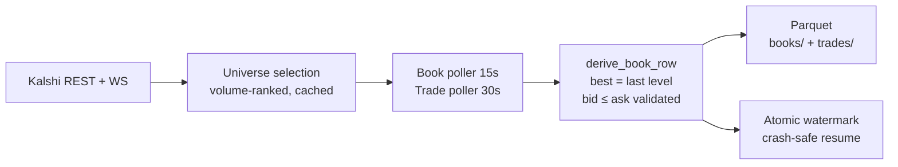

# kalshi-recorder

Kalshi's order books vanish the moment they change. This keeps them.

[](https://github.com/enonymous1/kalshi-recorder/actions/workflows/ci.yml)
[](LICENSE)
[](pyproject.toml)

A standalone recorder for Kalshi prediction markets. It captures order-book snapshots and trades to Parquet files, so you can study market microstructure later instead of watching it disappear in real time.

## Why

Kalshi has no historical order-book endpoint. Trades are retrievable after the fact; books are not. If you don't capture a book while it's live, it's gone forever. This recorder exists to close that gap: it runs headless, polls the top markets by volume, and writes queryable data you can analyze days later.

## Non-goals

- **Not a trading bot.** It places no orders and holds no positions.
- **Not a backtester.** Simulation lives in the parent project (`ss-predictionMarkets`); this only records.
- **Not historical backfill.** Capture is forward-only — it records from the moment you start it.
- **Not a dashboard.** There is no UI; the output is Parquet files you query yourself.

## Prerequisites

- Python 3.11+
- A Kalshi API key with **read-only** scope. It lives only on the recording host, in `.env` — never in chat, never in git.

## Quick Start

```bash
# Install (creates the `kalshi-record` console script)
pip install -e .

# Configure — copy the example and fill in your credentials
cp .env.example .env
# Edit .env: KALSHI_KEY_ID, KALSHI_PRIVATE_KEY_PATH, REC_* knobs

# Dry run (enumerate the universe, write nothing)
python -m data.recorder --dry-run

# Run in the foreground
kalshi-record
```

## What you get

One Parquet file per market per day, plus a watermark that lets the recorder resume after a crash without gaps or duplicates.

```python
import polars as pl

books = pl.scan_parquet("data/recordings/books/2026-10-19/*.parquet")
# Tightest spreads of the day
books.with_columns(spread=pl.col("yes_ask") - pl.col("yes_bid")).select(
    "ticker", "yes_bid", "yes_ask", "spread"
).sort("spread").head(5).collect()
```

Example book row (values illustrative):

| ticker | yes_bid | yes_ask | yes_bid_size | yes_ask_size |
|--------|---------|---------|--------------|--------------|
| KXNFLGAME-26OCT18BALCLE-CLE | 0.74 | 0.75 | 300 | 200 |

## How it works



Two details earned the hard way: Kalshi returns book levels **ascending (worst-first)**, so the best bid is the *last* element — reading the first recorded two days of bad data in October 2026. And the API reports live markets as `status='active'`, not `'open'` as the docs claim. Both are pinned by tests.

## macOS LaunchAgent

See `mac/README.md` for full deployment notes (TCC permissions, external volumes).

Install (edit paths in the plist first — it ships with `/path/to/kalshi-recorder` placeholders):
```bash
cp mac/com.kalshi-recorder.plist ~/Library/LaunchAgents/
launchctl load ~/Library/LaunchAgents/com.kalshi-recorder.plist
```

> Do NOT run this alongside the old `com.ss-predictionmarkets.recorder`
> LaunchAgent — two recorders will contend over the same watermark and
> Parquet files. Unload the old one first.

```bash
# Stop
launchctl unload ~/Library/LaunchAgents/com.kalshi-recorder.plist
# Tail logs
tail -f ~/Library/Logs/kalshi-recorder.log
```

<details>
<summary>Project structure</summary>

```
config/settings.py    # Configuration via .env (all REC_* knobs)
core/loop.py          # Event loop (uvloop where available)
core/logging.py       # Centralized logging setup
data/recorder.py      # Main orchestration (Recorder class + CLI)
data/kalshi.py        # Kalshi REST + WS clients (rate-limited, retry)
data/universe.py      # Universe selection & caching (175 markets by volume)
data/watermark.py     # Atomic watermark for crash-safe resume
data/schemas.py       # Parquet schemas & row derivation (with bid>ask validation)
data/networking.py    # TCP_NODELAY, TokenBucket, backoff, sleep_or_stop
data/auth.py          # Ed25519/RSA request signing, WS headers
mac/                  # LaunchAgent plist + README for macOS deployment
```

</details>

<details>
<summary>Configuration (.env)</summary>

| Key | Default | Notes |
|-----|---------|-------|
| `REC_MAX_MARKETS` | 175 | Universe size |
| `REC_MIN_VOLUME_24H` | 500 | Min $24h volume to qualify |
| `REC_UNIVERSE_INCLUDE` | (empty) | Empty = all categories (full universe) |
| `REC_ENUMERATE_HOURS` | 12 | Background re-enumeration interval |
| `REC_BOOK_POLL_S` | 15 | Book poll interval |
| `REC_TRADES_POLL_S` | 30 | Trade poll interval |

</details>

<details>
<summary>Data layout</summary>

```
data/recordings/
├── books/2026-10-19/<TICKER>.parquet   # Book snapshots (15s cadence)
├── trades/2026-10-19/<TICKER>.parquet  # Trades (30s cadence)
├── universe_cache.json                  # 175-market universe (6h TTL)
├── series_cache.json                    # Per-series market lists
└── watermark.json                       # Atomic resume state
```

Book schema: `ts_ns, ticker, yes_bid, yes_ask, no_bid, no_ask, *_size, source`.
`derive_book_row` validates `bid <= ask` and raises on violation (fail loud).

</details>

<details>
<summary>History</summary>

- 2026-10-25: README rewritten as a landing page; MIT LICENSE, CI workflow, and schema tests added
- 2026-10-24: Renamed from `ss-kalshi-recorder` to `kalshi-recorder` for portfolio use
- 2026-10-19: Extracted as standalone from `ss-predictionMarkets`
- 2026-10-18: Fixed critical book-parsing bug (`yes_dollars` ascending, not best-first)
- 2026-10-17: Fixed universe:0 bug (API returns `status='active'`, not `'open'`)
- 2026-10-15: Recorder split from 1,054-line monolith into 5 modules

</details>
